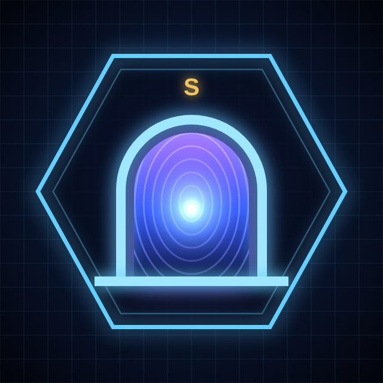

<p align="center"></p>

# Мисливець Брам

Українська рольова гра в Telegram. Ти загинув, але Система обрала твою душу: переродися мисливцем, зачищай брами й дійди до рангу S.

- **Грати в Telegram:** [@myslyvets_bram_bot](https://t.me/myslyvets_bram_bot)
- **Грати в браузері:** https://flimelk.github.io/myslyvets-bram/

## Що всередині

- 8 класів зі своїми навичками й пасивками
- 22 брами рангів E→S, випробування рангів на 8, 15, 22, 29 і 36 рівнях, Нескінченна брама
- покрокові бої з наміром ворога, замахом і Сокрушенням, авто-бій
- арена з рейтингом, фарм-зона, сумка, кузня, вівтар, квест дня, колесо долі, пошта, магазин

## Як це влаштовано

| Файл | Що робить |
| --- | --- |
| `index.html` | уся гра в одному файлі (HTML, CSS, JS); її віддає GitHub Pages |
| `bot/bot.py` | Telegram-бот без сторонніх бібліотек: `/start`, `/play`, `/help`, `/about`, кнопка «Грати» в меню |
| `bot/start.sh` | запускає бота у фоні; перший запуск просить токен від @BotFather і зберігає його в `bot/.env` |
| `bot/stop.sh` | зупиняє бота |
| `bot/admin.py` | адмін-панель: `/admin` — статистика гравців, останні гравці, розсилка з попереднім переглядом, експорт у CSV, стан бота, видача подарунків гравцям із веб-адмінки. Доступ — ID з `ADMIN_IDS` у `bot/.env` (за замовчуванням 1859870653) |
| веб-адмінка | у грі: «Ще» → «Адмін-панель» (видно лише адміну): видати собі валюту й зілля, рівень і ранг, створити будь-який предмет, скинути ліміти, надіслати подарунок гравцю за Telegram ID або всім |
| `setup.sh` | одноразове налаштування: репозиторій, GitHub Pages і запуск бота |

Прогрес гравця зберігається в хмарі Telegram (CloudStorage), а поза Telegram — у браузері.

## Бот на Mac

```bash
bash bot/start.sh   # запустити (після перезавантаження Mac — так само)
bash bot/stop.sh    # зупинити
tail -f bot/bot.log # подивитися лог
```

Бот працює, поки Mac увімкнений і не спить. Токен лежить лише в `bot/.env`, у git він не потрапляє.

## Оновити гру

Заміни `index.html`, зроби коміт і `git push` — GitHub Pages оновить гру за хвилину-дві.
